# PHASE 10C — AUTHENTIC L2 DATA QUALIFICATION REPORT

**Document Identifier**: `PHASE10C_DATA_QUALIFICATION_REPORT.md`  
**Phase**: Phase 10C Authentic L2 Data Acquisition & Qualification  
**Platform**: Jev Crypto-Trading Research System  
**Audit Date**: `2026-09-29T07:41:00+03:30`  
**Evaluation Engine**: `phase10c.adapter.TardisL2Adapter` + `phase10b.reconstructor.OrderBookReconstructor`  
**Safety Invariants**: `PAPER_TRADING_ONLY = true`, `USE_LIVE_JEV = false`, `LEVERAGE = 1.0`  
**Formal Gate Decision**: **`PARTIALLY_QUALIFIED`**  
**Data Sufficiency Finding**: **`DATA_SUFFICIENCY: INSUFFICIENT`**  
**Phase 10D Permission**: **`BLOCKED`**

---

## 1. Executive Summary

Phase 10C was commissioned to resolve the sole remaining blocker from Phase 10B.6: determining whether authentic historical event-level Level-2 (L2) order-book data can be obtained, imported, validated, and deterministically reconstructed using the existing Phase 10B infrastructure.

### Summary of Results:
1. **Authentic Data Validated**: The historical Binance.US dataset acquired from Tardis.dev (`sample_binance-us_incremental_book_L2_2024-03-01_BTCUSDT.csv` and `sample_binance-us_trades_2024-03-01_BTCUSDT.csv`) was parsed and qualified using the newly developed `TardisL2Adapter` in `phase10c/adapter.py`.
2. **Deterministic Order-Book Reconstruction Success**: In strict mode (`strict_mode=True`), the Phase 10B `OrderBookReconstructor` achieved **100.0% reconstruction success** across all 2,231 delta packets (7,996 deltas) without a single sequence gap, out-of-order timestamp, or crossed-book event.
3. **Data Sufficiency Assessment**: The sample duration spans 478.6 seconds (~8 minutes, with full-day coverage available for March 1, 2024). However, Phase 10A requires **30 continuous consecutive days** to evaluate passive queue fill probabilities across diverse volatility regimes and maintain an out-of-sample holdout.
4. **Final Qualification Gate**:
   ```text
   TECHNICAL VALIDITY:      VALID (100% Deterministic Reconstruction)
   DATA SUFFICIENCY:        INSUFFICIENT (Coverage < 30 Continuous Days)
   FINAL GATE DECISION:     PARTIALLY_QUALIFIED
   PHASE 10D PERMISSION:    BLOCKED (Cannot advance until 30-day dataset acquired)
   ```

---

## 2. Dataset Provenance & Cryptographic Verification

| Attribute | Incremental Book L2 Dataset | Tick Trades Dataset |
| :--- | :--- | :--- |
| **Provider** | Tardis.dev (Public Sample Tier) | Tardis.dev (Public Sample Tier) |
| **Source URL** | `https://datasets.tardis.dev/v1/binance-us/incremental_book_L2/2024/03/01/BTCUSDT.csv.gz` | `https://datasets.tardis.dev/v1/binance-us/trades/2024/03/01/BTCUSDT.csv.gz` |
| **Local File Path** | `phase10b4/data/sample_binance-us_incremental_book_L2_2024-03-01_BTCUSDT.csv` | `phase10b4/data/sample_binance-us_trades_2024-03-01_BTCUSDT.csv` |
| **File Size (Bytes)** | 769,334 bytes (0.73 MB) | 413,706 bytes (0.39 MB) |
| **SHA-256 Hash** | `e1d441162391ce42484f910ea0937a0928f6458564b1f41da50a80e0c0df545b` | `5b306b9b3aa5ca47c0bbfdf072ec8aa12ff314041b3152661ae50ef3da2535d9` |
| **Exchange / Venue** | Binance.US (`binance-us`) | Binance.US (`binance-us`) |
| **Market / Symbol** | Spot / `BTCUSDT` | Spot / `BTCUSDT` |
| **Date Coverage** | `2024-03-01 00:00:01` to `2024-03-01 00:07:59` UTC | `2024-03-01 00:00:06` to `2024-03-01 12:41:17` UTC |
| **Chronological Duration** | 478.63 seconds (7.98 minutes) | 45,671.35 seconds (12.69 hours) |
| **Acquisition Cost** | $0.00 (Freely available public sample) | $0.00 (Freely available public sample) |
| **Adapter Version** | `phase10c.adapter.TardisL2Adapter v1.0` | `phase10c.adapter.TardisL2Adapter v1.0` |

---

## 3. Data Contract & Schema Mapping

The raw CSV fields map losslessly to the canonical Phase 10B data models:

```mermaid
flowchart LR
    subgraph RawTardisCSV ["Raw Tardis CSV Format"]
        R1[exchange, symbol]
        R2[timestamp us]
        R3[local_timestamp us]
        R4[is_snapshot true/false]
        R5[side bid/ask]
        R6[price, amount]
    end

    subgraph Adapter ["phase10c.adapter.TardisL2Adapter"]
        Sync[Binance Buffer Sync\nDrop deltas <= snapshot_ts]
        Group[Atomic Packet Grouping\nBy local_timestamp]
        Convert[Unit Conversion\nus // 1000 -> ms]
    end

    subgraph Phase10BModels ["Phase 10B Canonical Models"]
        M1[L2Snapshot\nbids, asks, ts_ms]
        M2[L2DeltaPacket\nfirst_update_id, final_update_id]
        M3[L2Delta\nprice, quantity, side]
        M4[TickTrade\ntrade_id, aggressor_side]
    end

    RawTardisCSV --> Adapter
    Adapter --> Phase10BModels
```



### Protocol Field Correspondence:

| Field Name | Raw Type | Canonical Target | Semantic Role in Reconstructor |
| :--- | :--- | :--- | :--- |
| `exchange` | string | `exchange: str` | Venue identifier (`binance-us`) |
| `symbol` | string | `symbol: str` | Trading pair (`BTCUSDT`) |
| `timestamp` | integer (us) | `exchange_timestamp_ms: int` | Matching engine event timestamp (converted from $\mu s$ to $ms$) |
| `local_timestamp` | integer (us) | `local_receive_timestamp_ms: int` | Recorder capture timestamp (used for atomic packet batching) |
| `is_snapshot` | boolean | Dispatches `L2Snapshot` vs `L2Delta` | Builds initial ladder if true; incremental updates if false |
| `side` | string | `BookSide.BID` / `BookSide.ASK` | Directs update to proper price ladder |
| `price` | float | `price: float` | Price level index in order book |
| `amount` | float | `quantity: float` | Depth at price level; `0.0` signals price level deletion |

---

## 4. Empirical Qualification Metrics

### 4.1. Data Integrity & Completeness Audit

| Metric | Measured Value | Standard Required | Status |
| :--- | :--- | :--- | :--- |
| **Total CSV Records** | 9,999 records | > 0 | **PASS** |
| **Snapshot Records** | 2,002 records | Complete depth snapshot | **PASS** |
| **Incremental Delta Records** | 7,997 records | Continuous stream | **PASS** |
| **Duplicate Records** | 0 records | 0 | **PASS** |
| **Malformed Records** | 0 records | 0 | **PASS** |
| **Missing Fields** | 0 records | 0 | **PASS** |
| **Invalid Prices ($p \le 0$)** | 0 records | 0 | **PASS** |
| **Negative Quantities ($q < 0$)** | 0 records | 0 | **PASS** |
| **Timestamp Ordering Violations** | 0 violations | 0 | **PASS** |

### 4.2. Order-Book Sequence & Reconstruction Quality

| Metric | Measured Value | Threshold / Target | Status |
| :--- | :--- | :--- | :--- |
| **Initial Sequence ID** | 1 | 1 | **PASS** |
| **Final Sequence ID** | 2,232 | Monotonically increasing | **PASS** |
| **Total Delta Packets Applied** | 2,231 packets | 2,231 | **PASS** |
| **Total Deltas Applied** | 7,996 deltas | 7,996 | **PASS** |
| **Pre-Snapshot Discarded Deltas** | 1 delta | Invariant: $\le snapshot\_ts$ | **PASS** (Binance sync invariant) |
| **Snapshot Zero-Levels Filtered** | 2 levels | Empty price levels | **PASS** |
| **Sequence Gaps Count** | 0 gaps | 0 | **PASS** |
| **Reconstruction Success Rate** | **100.0%** | 100.0% | **PASS** |
| **Crossed-Book Occurrences** | **0 occurrences** | 0 | **PASS** |
| **Best Bid < Best Ask Maintained** | **100.0% of states** | 100.0% | **PASS** |

### 4.3. Microstructural Market Telemetry

| Telemetry Metric | Measured Value | Interpretation |
| :--- | :--- | :--- |
| **Initial Best Bid** | $61,121.32 | Valid resting bid at UTC 00:00:01 |
| **Initial Best Ask** | $61,189.05 | Valid resting ask at UTC 00:00:01 |
| **Initial Spread** | $67.73 (11.08 bps) | Normal wider spread during midnight UTC rollover |
| **Final Best Bid** | $61,283.05 | Reconstructed bid at UTC 00:07:59 |
| **Final Best Ask** | $61,302.42 | Reconstructed ask at UTC 00:07:59 |
| **Final Spread** | $19.37 (3.16 bps) | Normal intraday spot spread |
| **Minimum Observed Spread** | $10.11 (1.65 bps) | Tightest book spread during test interval |
| **Maximum Observed Spread** | $103.21 (16.86 bps) | Widest book spread during burst trade activity |
| **Average Observed Spread** | $54.54 (8.90 bps) | Mean spread across 2,231 reconstructed states |

### 4.4. Tick Trades Qualification

| Trades Metric | Measured Value | Notes |
| :--- | :--- | :--- |
| **Total Executed Trades** | 4,999 trades | Continuous execution over 12.69 hours |
| **Buyer-Aggressor Trades (BUY)** | 3,369 trades (67.4%) | Net aggressive buying pressure |
| **Seller-Aggressor Trades (SELL)** | 1,630 trades (32.6%) | Aggressive selling fills |
| **Total Traded Volume** | 34.4346 BTC | ~$2.12M USD equivalent traded |
| **Price Range** | $60,755.00 – $62,484.53 | Reflects authentic 2024-03-01 market regime |

---

## 5. Minimum Sample Requirement & Sufficiency Audit

To prevent false confidence, the dataset was evaluated against the preregistered Phase 10A research standard (`PHASE10A_DATA_REQUIREMENTS.md`):

```text
CRITICAL SUFFICIENCY CRITERIA:
1. Chronological Coverage: Minimum 30 consecutive continuous calendar days.
   - Observed in current authentic sample: 478.6 seconds (~8 minutes).
   - Maximum available via free 1st-of-month: 1 disconnected day per month.
   - VERDICT: FAIL (Insufficient duration).

2. Regime Diversity: Must encompass low, medium, and extreme volatility regimes.
   - Observed: Single market regime (March 1, 2024 trending bull market).
   - VERDICT: FAIL (No bear/high-volatility regime coverage).

3. Out-of-Sample Holdout: Sealed 20% holdout required to prevent data snooping.
   - Observed: Sample size too small to partition into 60/20/20 train/validation/holdout.
   - VERDICT: FAIL (Sample cannot support uncompromised partitioning).
```

### Formal Sufficiency Classification:
$$\text{DATA\_SUFFICIENCY} = \mathbf{INSUFFICIENT}$$

---

## 6. Scientific Separation & Invariant Audit

The following distinctions are preserved without exception:

1. **`AUTHENTIC_L2_DATA` $\neq$ `OHLCV_PROXY`**:
   The existing OHLCV 5m candles in `data/historical/` and `data/phase9_data/` were tested against `TardisL2Adapter` and were **strictly rejected**. No candle data was used to infer book depth.
2. **`AUTHENTIC_L2_DATA` $\neq$ `SYNTHETIC_DATA`**:
   No synthetic tick generators or simulated order books were used to backfill missing days.
3. **Safety Invariants Maintained**:
   - `PAPER_TRADING_ONLY = True`
   - `USE_LIVE_JEV = False`
   - `LEVERAGE = 1.0`
   - `LIVE_ORDERS = 0`
   - `WALLET_CONNECTIONS = 0`
   - `PRIVATE_KEYS = 0`
4. **Research Freeze Intact**:
   Phase 9D/9E empirical findings (-36.1 bps holdout net return, 38–44 bps taker friction, all hypotheses rejected) remain active and unmodified.

---

## 7. Final Gate Decision & Phase 10D Status

In strict accordance with the Phase 10C specification:

```text
======================================================================
  PHASE 10C FINAL QUALIFICATION GATE DECISION
======================================================================
  Technical Validity:    VALID (Reconstruction verified with 100% fidelity)
  Data Sufficiency:      INSUFFICIENT (Duration < 30 continuous days)
  Final Phase 10C Gate:  PARTIALLY_QUALIFIED
  Phase 10D Permission:  BLOCKED
======================================================================
```

### Exact Remaining Blocker:
To advance to Phase 10D (Passive Execution & Queue Dynamics Alpha Research), the project requires a verified, continuous 30-day historical L2 dataset for Binance.US (`BTCUSDT`, `ETHUSDT`, `SOLUSDT`). 

Because commercial procurement ($300 minimum order) is disallowed under the zero-cost research constraint, and public free archives only provide 1st-of-month samples, the research remains honestly and scientifically halted at this boundary.

**Phase 10D may NOT begin.**
